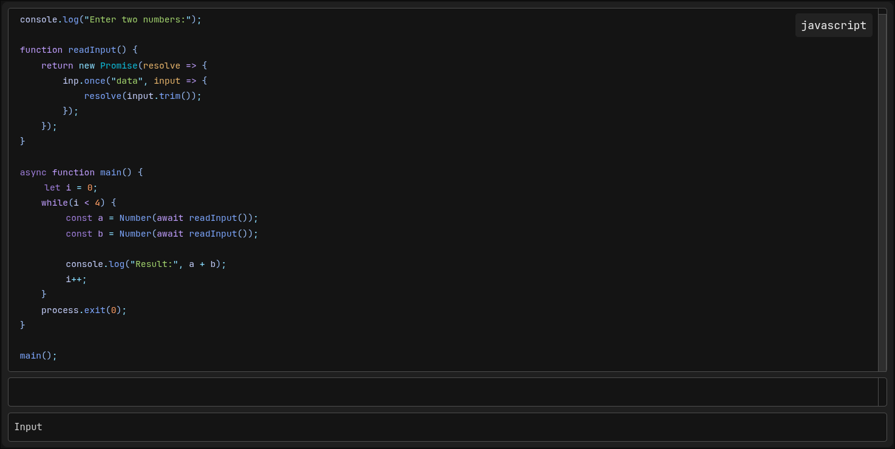

# CodeBlocks++
[CodeBlocks++](https://github.com/CommandJoo/CodeBlocksPlusPlus) is a plugin for Obsidian that allows you to define custom Codeblocks
which can be highlighted and executed. It allows for general customization aswell as individual styling using metadata properties.


## Installation
Go into your Obsidian Vault
```sh
cd .obsidian/plugins
git clone https://github.com/CommandJoo/CodeBlocksPlusPlus.git
```
Go into your Obsidian Settings / Community Plugins and enable it.

## Usage
### Codeblock Syntax
To use executable Codeblocks define a Codeblock with the language "cbpp".

Settings for a specific Codeblock can be specified by the "@cbpp:" prefix.
~~~markdown
```cbpp
@cbpp:lang=js
@cbpp:theme=monokai
@cbpp:input=false
function hello() {
	console.log("Hello, World!");
}
```
~~~~

These settings will automatically removed by the renderer.

Alternatively you can also allow inline metadata in the settings allowing, the codeblock to define the language directly inside the first line.
~~~markdown
```cbpp js
function hello() {
	console.log("Hello, World!");
}
```
~~~
This allows for a much cleaner syntax.

### List of Codeblock Settings
| Setting  | Value      | Description                                                                                          |
|----------|------------|------------------------------------------------------------------------------------------------------|
| 	lang     | \<string>  | A language provided by Shikis bundled languages                                                      |
| theme    | \<string>  | A theme provided by Shiki used for syntax highlighting *(overwrites the settings value)*             |
| numbers  | \<boolean> | Whether or not line numbers should be displayed                    *(overwrites the settings value)* |
| runnable | \<boolean> | Whether or not the Codeblock will be executable *(overwrites the settings value)*                    |
| input    | \<boolean> | Whether or not there should be an input field for the user *(overwrites the settings value)*         |

### Registering Languages
In order to execute Codeblocks you need to register languages with an interpreter 
in the Settings tab of this Plugin

## Credits
- [Shiki](https://github.com/shikijs/shiki), used for Syntax highlighting in rendered Codeblocks

## If this plugin has helped you consider giving it a ⭐
